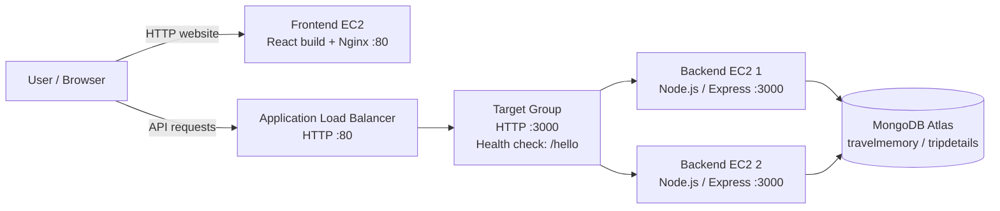
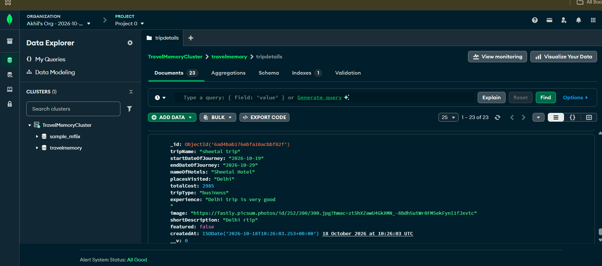
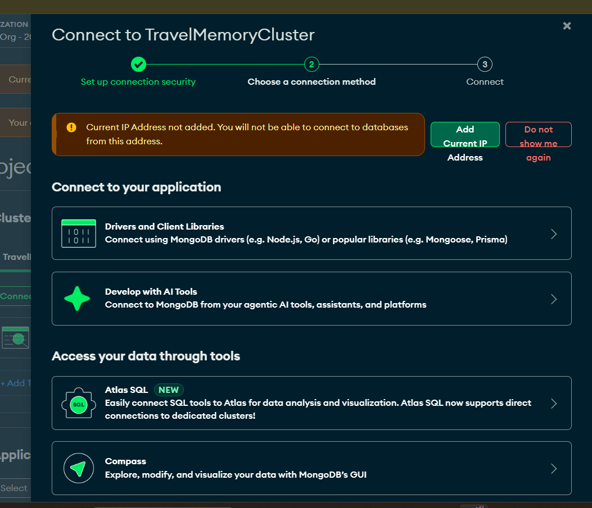
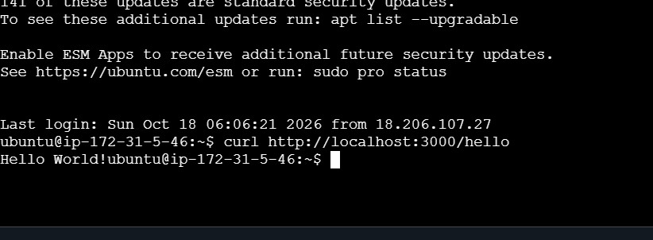
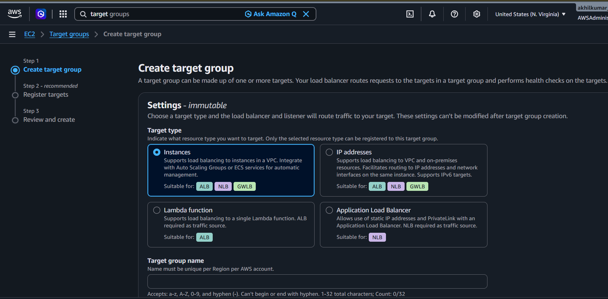
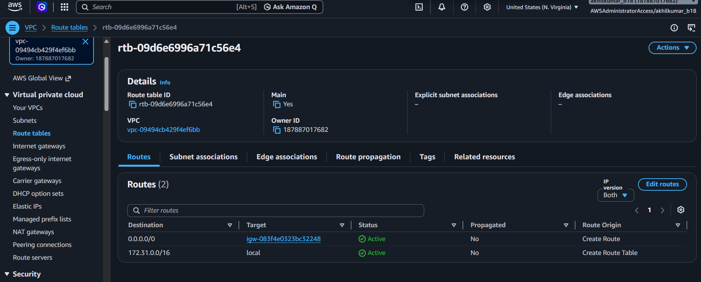
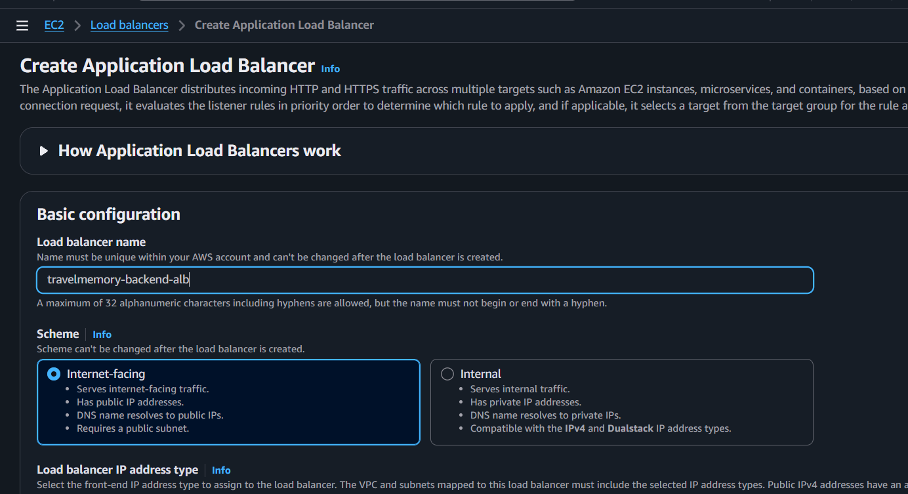
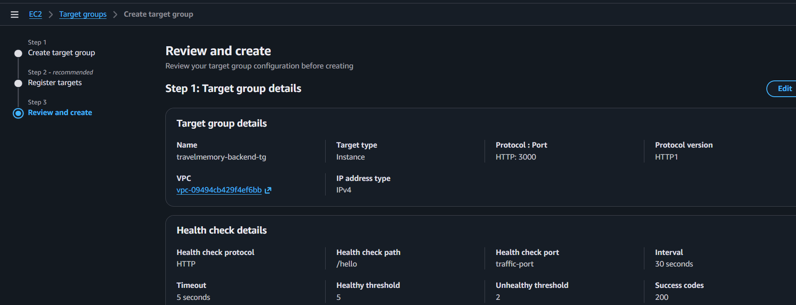

# TravelMemory — AWS Cloud Deployment

A deployment of the **TravelMemory** MERN application using **MongoDB Atlas**, **Node.js/Express**, **React**, **Nginx**, **Amazon EC2**, and an **Application Load Balancer (ALB)**.

**Repository:** [TravelMemory-Cloud-Deployment](https://github.com/errajputakhil777-oss/TravelMemory-Cloud-Deployment)

> **Important:** This README documents the setup performed for the assignment. Replace example IP addresses or ALB DNS names if AWS assigns new ones. Never publish your MongoDB password, `.env` file, AWS keys, or private SSH key.

## Contents

- [Architecture](#architecture)
- [Technology stack](#technology-stack)
- [Deployment steps](#deployment-steps)
  - [1. Configure MongoDB Atlas](#1-configure-mongodb-atlas)
  - [2. Connect to EC2 and clone the project](#2-connect-to-ec2-and-clone-the-project)
  - [3. Configure the Node.js backend](#3-configure-the-nodejs-backend)
  - [4. Build the React frontend](#4-build-the-react-frontend)
  - [5. Configure Nginx](#5-configure-nginx)
  - [6. Create the target group](#6-create-the-target-group)
  - [7. Create the Application Load Balancer](#7-create-the-application-load-balancer)
  - [8. Test the application and database](#8-test-the-application-and-database)
  - [9. Push the project to GitHub](#9-push-the-project-to-github)
- [Useful commands](#useful-commands)
- [Security notes](#security-notes)
- [Screenshots](#screenshots)

## Architecture



### Request flow

1. A browser loads the React frontend served by Nginx.
2. The frontend sends API requests to the backend ALB DNS name.
3. The ALB forwards requests to a healthy EC2 backend target on port `3000`.
4. The Express application reads and writes trip records in MongoDB Atlas.
5. The target group's `/hello` health check verifies that the backend responds.

**Deployment note:** The initial frontend was tested at the EC2 public IP. If the frontend is served separately from the backend ALB, update `frontend/src/url.js` to use the ALB DNS name as its API base URL, rebuild the React app, and copy the new build to the frontend web root.

## Technology stack

- **Frontend:** React (`react-scripts`), HTML, CSS, JavaScript
- **Web server / reverse proxy:** Nginx
- **Backend:** Node.js, Express
- **Database:** MongoDB Atlas
- **Cloud:** AWS EC2, Application Load Balancer, Target Group, VPC subnets and security groups
- **Source control:** Git and GitHub

## Deployment steps

### 1. Configure MongoDB Atlas

1. Sign in to [MongoDB Atlas](https://cloud.mongodb.com).
2. Select the organization and project that contain `TravelMemoryCluster`.
3. Open **Database / Data Explorer**.
4. Expand the `travelmemory` database and select the `tripdetails` collection.
5. Confirm that documents are present. The screenshot below shows the `tripdetails` collection and saved trip records.



6. Open **Security → Network Access** and add the backend EC2 outbound public IP address to the IP access list. For a separate Compass connection from your computer, use **Add Current IP Address** for your computer as well.
7. Open **Security → Database Access** and create/verify a database user with the permissions required by the application.
8. Open **Database → Connect → Drivers**, choose Node.js, and copy the connection string.
9. Replace the placeholders in the connection string with your actual database username, password and cluster hostname. Do not put the real password in this README or in screenshots.

Atlas connection dialog evidence:



### 2. Connect to EC2 and clone the project

1. Sign in to the [AWS Console](https://console.aws.amazon.com/).
2. Open **EC2 → Instances**.
3. Select the backend EC2 instance and click **Connect → EC2 Instance Connect → Connect**.
4. Run:

```bash
cd ~
git clone https://github.com/UnpredictablePrashant/TravelMemory.git
cd ~/TravelMemory
ls
```

The project contains `backend/` and `frontend/` directories.



### 3. Configure the Node.js backend

1. Install the backend dependencies:

```bash
cd ~/TravelMemory/backend
npm install
```

2. Create the environment file:

```bash
nano .env
```

3. Add the following values, using your own valid Atlas connection string:

```dotenv
PORT=3000
MONGO_URI=mongodb+srv://<database-user>:<database-password>@<cluster-host>/travelmemory?retryWrites=true&w=majority
```

4. Save in nano with `Ctrl+O`, press `Enter`, then `Ctrl+X`.
5. Restrict permissions:

```bash
chmod 600 .env
```

6. Configure the backend service at `/etc/systemd/system/travelmemory-backend.service`:

```ini
[Unit]
Description=TravelMemory Node.js Backend
After=network.target

[Service]
Type=simple
User=ubuntu
WorkingDirectory=/home/ubuntu/TravelMemory/backend
EnvironmentFile=/home/ubuntu/TravelMemory/backend/.env
Environment=NODE_ENV=production
ExecStart=/usr/bin/node /home/ubuntu/TravelMemory/backend/index.js
Restart=on-failure
RestartSec=5

[Install]
WantedBy=multi-user.target
```

Create/edit it with:

```bash
sudo nano /etc/systemd/system/travelmemory-backend.service
```

7. Enable and start the service:

```bash
sudo systemctl daemon-reload
sudo systemctl enable --now travelmemory-backend
sudo systemctl status travelmemory-backend --no-pager
```

8. Test the local backend:

```bash
curl http://localhost:3000/hello
```

Expected response:

```text
Hello World!
```

### 4. Build the React frontend

1. Open the frontend folder:

```bash
cd ~/TravelMemory/frontend
```

2. Edit the API base URL:

```bash
nano src/url.js
```

3. For the initial single-EC2 test, the base URL was set to the EC2 public IP:

```javascript
export const baseUrl =
  process.env.REACT_APP_BACKEND_URL || "http://44.213.63.113";
```

Use the current EC2 public IP if it has changed. For a separated frontend/backend setup, use the backend ALB DNS name instead and rebuild.

4. Install dependencies and build:

```bash
npm install
npm run build
```

A successful build creates the `build/` directory. ESLint warnings may appear; review them, but warnings alone do not necessarily prevent the production build.

### 5. Configure Nginx

1. Copy the React production build to the Nginx web root:

```bash
sudo mkdir -p /var/www/travelmemory
sudo cp -r ~/TravelMemory/frontend/build/. /var/www/travelmemory/
sudo chown -R www-data:www-data /var/www/travelmemory
```

2. Create/edit the Nginx site:

```bash
sudo nano /etc/nginx/sites-available/travelmemory-backend
```

3. Configure the frontend and API proxy:

```nginx
server {
    listen 80 default_server;
    server_name _;

    root /var/www/travelmemory;
    index index.html;

    location / {
        try_files $uri $uri/ /index.html;
    }

    location /hello {
        proxy_pass http://127.0.0.1:3000;
        proxy_set_header Host $host;
        proxy_set_header X-Real-IP $remote_addr;
        proxy_set_header X-Forwarded-For $proxy_add_x_forwarded_for;
    }

    location /trip {
        proxy_pass http://127.0.0.1:3000;
        proxy_set_header Host $host;
        proxy_set_header X-Real-IP $remote_addr;
        proxy_set_header X-Forwarded-For $proxy_add_x_forwarded_for;
    }
}
```

4. Enable the configuration and validate it:

```bash
sudo ln -s /etc/nginx/sites-available/travelmemory-backend /etc/nginx/sites-enabled/travelmemory-backend
sudo rm -f /etc/nginx/sites-enabled/default
sudo nginx -t
sudo systemctl reload nginx
```

If the symlink already exists, `ln` may report that the file exists; do not create duplicate links. Then test:

```bash
curl http://localhost/hello
```

Expected response: `Hello World!`

5. Open `http://<frontend-ec2-public-ip>` in a browser to check the React app.

### 6. Create the target group

1. In AWS Console, open **EC2 → Target Groups → Create target group**.
2. Choose **Instances** as the target type.
3. Enter `travelmemory-backend-tg` as the target group name.
4. Set protocol to **HTTP** and port to **3000**.
5. Select the VPC used by the backend EC2 instances.
6. Set the health check protocol to **HTTP** and the health check path to `/hello`.
7. Register both backend EC2 instances on port `3000`.
8. Create the target group, open its **Targets** tab, and wait until both targets show **Healthy**.





### 7. Create the Application Load Balancer

1. In AWS Console, open **EC2 → Load Balancers → Create load balancer**.
2. Choose **Application Load Balancer**.
3. Enter `travelmemory-backend-alb` as the name.
4. Choose **Internet-facing** and IPv4.
5. Select the same VPC and at least two public subnets in different Availability Zones.
6. Select/create a load balancer security group that allows inbound HTTP on port `80`.
7. Add an HTTP listener on port `80` and forward the default action to `travelmemory-backend-tg`.
8. Create the load balancer and wait until its state becomes **Active**.
9. Copy the ALB DNS name from the load balancer details.
10. In the backend instances' security group, allow TCP port `3000` **from the ALB security group**. Do not open port `3000` to all internet addresses.
11. Test the ALB:

```bash
curl http://<backend-alb-dns-name>/hello
```

Expected response:

```text
Hello World!
```

Screenshots of the load balancer setup and status:





### 8. Test the application and database

1. Open the deployed TravelMemory frontend.
2. Select **Add Experience**.
3. Enter a sample trip and click **Submit**.
4. Open browser developer tools with `F12`, then select **Network → Fetch/XHR**.
5. Select the `POST /trip` request and confirm status `200 OK`.
6. The successful submission returned `Trip added Successfully`.
7. Open the trip details page and confirm the new trip is displayed.
8. Return to **MongoDB Atlas → Data Explorer → travelmemory → tripdetails** and confirm the new document is present.

The Atlas screenshot earlier in this README shows the collection and saved records. Use your actual current browser screenshot of the successful form submission and details page if you want to add more visual proof to the repository.

### 9. Push the project to GitHub

Repository URL: [https://github.com/errajputakhil777-oss/TravelMemory-Cloud-Deployment](https://github.com/errajputakhil777-oss/TravelMemory-Cloud-Deployment)

From the project root:

```bash
cd ~/TravelMemory
git remote -v
git remote set-url origin https://github.com/errajputakhil777-oss/TravelMemory-Cloud-Deployment.git
git status
git add .
git commit -m "Document TravelMemory AWS deployment"
git push -u origin main
```

If Git says there is nothing to commit, check `git status` and run `git push` if the changes are already committed. If your active branch is not `main`, check it with:

```bash
git branch --show-current
```

**Never commit `.env`, passwords, access tokens, or private keys.** Check before pushing:

```bash
git status --short
git check-ignore -v backend/.env
```

To update this README, save it as `README.md` at the root of your GitHub repository. Put the screenshots in `` as included in this package, then commit and push both the README and screenshots.

## Useful commands

| Purpose | Command |
|---|---|
| Check backend service | `sudo systemctl status travelmemory-backend --no-pager` |
| View backend logs | `sudo journalctl -u travelmemory-backend -n 50 --no-pager` |
| Test Node backend | `curl http://localhost:3000/hello` |
| Test Nginx proxy | `curl http://localhost/hello` |
| Validate Nginx config | `sudo nginx -t` |
| Reload Nginx | `sudo systemctl reload nginx` |
| Rebuild frontend | `cd ~/TravelMemory/frontend && npm run build` |

## Security notes

- Keep `backend/.env` out of Git.
- Do not share MongoDB credentials or AWS access keys.
- Allow public HTTP on the ALB as required; restrict backend port `3000` to the ALB security group.
- Restrict SSH port `22` to your own IP address where possible.
- If an EC2 public IP changes, update any relevant MongoDB Atlas IP access entry and frontend API configuration.
- AWS load balancers and running EC2 instances can incur charges. Delete resources that are no longer required after assessment if you do not need them running.

## Screenshots

The `` directory in this package contains the deployment evidence screenshots available from the working session, including MongoDB Atlas and AWS console/terminal evidence. GitHub displays README images only when the referenced files have also been committed to the repository. [GitHub documentation: README files and relative image paths](https://docs.github.com/en/repositories/managing-your-repositorys-settings-and-features/customizing-your-repository/about-readmes).
